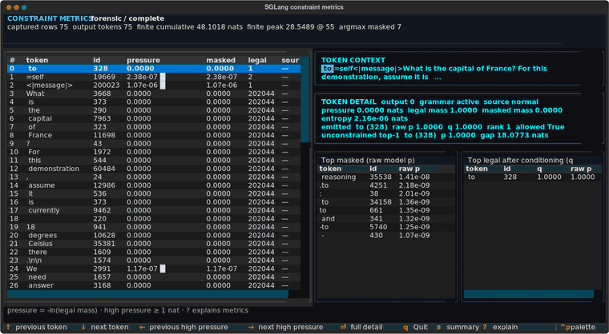
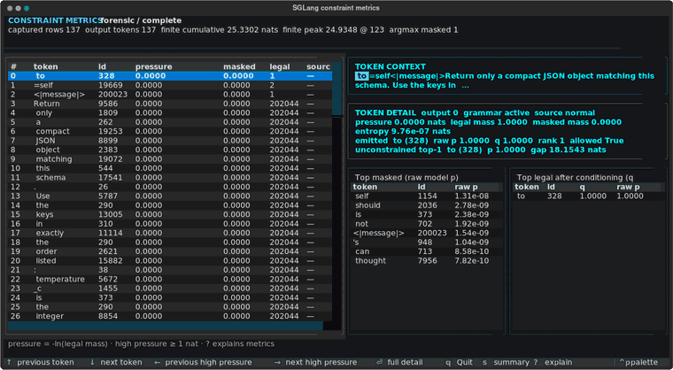
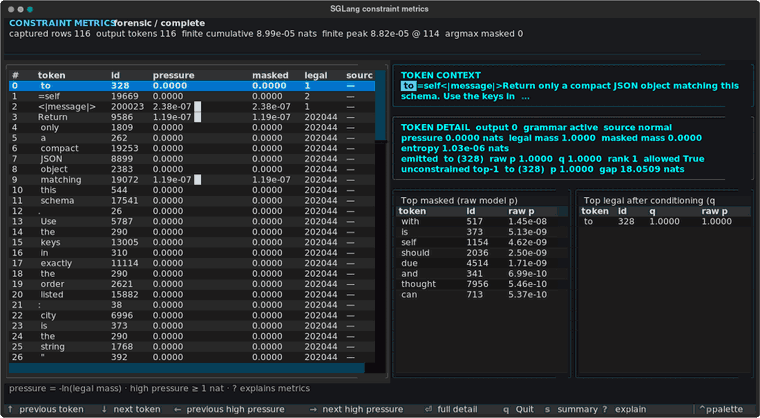

# Structured-output pressure demo

This three-part Muse-Glimmer demo separates the part of a constrained
generation that costs the model nothing from the part where the constraint
overrules it.

Every case uses one grammar, [`chat_turn_json.lark`](chat_turn_json.lark). It is
[`../muse_glimmer/chat_turn.lark`](../muse_glimmer/chat_turn.lark) with a single
rule replaced:

```lark
// calibration grammar: the answer body is free text
answer_turn: to_user_header content_nonempty eot

// this demo: the answer body is the JSON schema
answer_turn: to_user_header json_answer eot
```

Everything else is identical, and a test enforces that. The prompt ends at
`<|start|>assistant`, so the recipient marker, any `to=self` reasoning, and the
answer header are all generated under the grammar rather than prefilled. Those
tokens are ones the model already wanted to emit, so they should measure at
essentially zero pressure — which makes the pressure that does appear
attributable to the schema alone, inside the same capture.

The three prompts differ only in what they ask for:

1. `01_unprompted` asks an ordinary question without mentioning JSON. The model
   reasons, then wants prose; the schema overrules it at the answer boundary.
2. `02_order_mismatch` asks for the schema's fields in reverse order. The model
   wants JSON, so the boundary is cheap and the conflict lands on the first
   field name instead.
3. `03_order_match` asks for the same fields in schema order. The prompt and the
   schema agree, so the grammar never overrules the model.

The public model is `meta-models/Muse-Glimmer-30B` at revision
`a4e59da52a7bc87ae7251dd5545c0dd437c44b68`. Human-readable rendered contexts are
in `prompts/`; the grammar contains tokenizer IDs, so the server and the capture
must pin the same revision.

## What the capture shows

| Case | Free tokens before the answer | Peak pressure among them | Masked argmax | Peak pressure | Where the peak lands |
| --- | ---: | ---: | ---: | ---: | --- |
| No JSON instruction | 55 | 2.2e-06 nats | 7 | 28.55 nats | the first JSON token; the model wanted `The` |
| Reverse field order | 122 | 3.6e-07 nats | 1 | 24.93 nats | the first field name; emits `city`, wanted `temperature` |
| Matching field order | 101 | 6.0e-07 nats | 0 | 8.8e-05 nats | nowhere |

Each recording below walks the viewer from the first output token to the last,
lingering wherever the grammar contests a token. They are rendered from the
committed captures by [`render_gifs.py`](render_gifs.py), which needs `cairosvg`
and `ffmpeg` on top of the viewer extra.

**No JSON instruction** — 55 tokens of reasoning at zero pressure, then 28.55
nats the instant the answer turn opens:



**Reverse field order** — the model writes its preferred key order inside its own
reasoning for free, then loses one token of it to the schema:



**Matching field order** — the pressure column never leaves zero:



Reading across the rows: the grammar governs every token in all three cases, but
for the tokens the model was going to emit anyway it is inert to roughly six
decimal places, including a hundred-plus tokens of reasoning it never sees the
inside of. The cost shows up only where the schema and the model disagree, and
it moves as the disagreement moves. Asking for JSON at all is what makes the
answer boundary expensive in the first case; once the model intends JSON, the
boundary is free and the remaining conflict is one field name. In the reverse
order case that single token carries 24.93 of the request's 25.33 total nats.

Exact values move with SGLang, model, and batch composition. The invariant is
the shape.

## Capturing

Start a compatible server (the deployment cap must cover the requested forensic
`top_k`):

```bash
SGLANG_PLUGINS=constraint_metrics \
SGLANG_CONSTRAINT_METRICS_MAX_TOP_K=8 \
sglang serve \
  --model-path meta-models/Muse-Glimmer-30B \
  --revision a4e59da52a7bc87ae7251dd5545c0dd437c44b68 \
  --grammar-backend llguidance \
  --max-running-requests 8
```

Then replay every request:

```bash
python examples/structured_output/run_demo.py \
  --url http://localhost:30000 \
  --model meta-models/Muse-Glimmer-30B
```

The runner recursively discovers JSON files under `requests/` instead of
enumerating demo cases. For each single-request payload, it preserves other
sampling parameters, forces non-streaming forensic metrics, and mirrors the
relative path into:

- `submitted_requests/`: the exact bytes posted to `/generate`
- `responses/`: the complete response JSON, newline-normalized for the repository
- `token_labels/`: token text needed by the offline TUI

This layout also accepts a directory of requests dumped from an eval. One bad
request does not prevent the rest from being captured, and the command exits
nonzero after finishing if any request failed. Other sampling parameters are
preserved; only `stream` and `sampling_params.constraint_metrics` are replaced.

Captured requests may contain private prompts. Use output directories outside
this checkout for private eval data, and review files before committing them.

## Expectations

Optional `*.expect.json` files next to requests describe qualitative summary
bounds and token evidence. Tests check them, while the replay tool ignores them
as input requests.

The committed expectations are predictions written before the capture, not a
transcript of it. Every case asserts the same envelope claim — each token
labeled `" to"`, `"=user"`, or `"<|message|>"` stays below `1e-3` nats and is
never a masked argmax — and then one case-specific claim about where the schema
does bite. A capture that contradicts a prediction is a result worth reading,
not a bound to relax.

Until a capture exists, the fixture test skips and the grammar and request tests
still run.

## Viewing

Open a saved case completely offline:

```bash
sglang-constraint-metrics-view \
  --response examples/structured_output/responses/02_order_mismatch.json \
  --token-labels examples/structured_output/token_labels/02_order_mismatch.json
```

The viewer opens parked on the highest-pressure token, so `02_order_mismatch`
lands directly on the `city` row with `temperature` shown as the token the model
preferred. `k` scrolls back through the reasoning that preceded it, where the
pressure column reads zero for a hundred consecutive tokens; `n` and `p` jump
between high-pressure tokens, and `enter` opens the full candidate detail.
